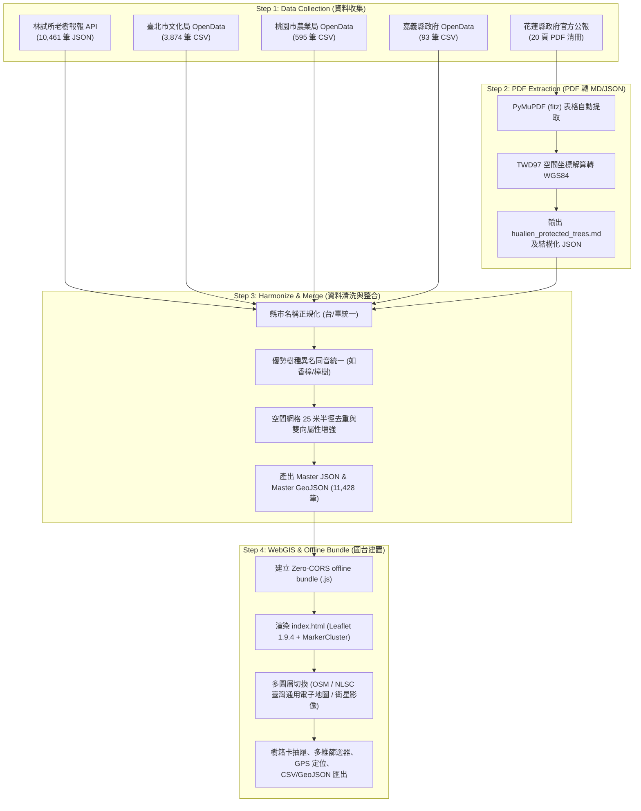

# 臺灣受保護樹木與珍貴老樹 WebGIS 全自動管線工作流說明書
(Taiwan Protected Trees & Precious Old Trees WebGIS Pipeline Workflow)

## 一、 專案緣起與法規標準 (Legal Framework & Governance)

在臺灣，樹木保育主要依據**《森林法》第五章之一「樹木保護專章」**（第38條之2至第38條之6）以及中央農業部訂定之《森林以外之樹木普查方法及受保護樹木認定標準》辦理。地方政府（直轄市、縣市政府）每 5 年須辦理一次轄區樹木普查，並依法造冊公告受保護樹木。

### 受保護樹木之法定認定標準：
1. **樹齡**：推估樹齡達 100 年以上（部分地方自治條例，如臺北市、臺中市定為 50 年以上）。
2. **規格規格**：
   - 闊葉樹：樹胸高直徑 (DBH) 達 1.5 公尺以上，或樹胸圍達 4.7 公尺以上。
   - 針葉樹：樹胸高直徑 (DBH) 達 0.75 公尺以上，或樹胸圍達 2.4 公尺以上。
   - 榕屬特殊樹種：氣生根與複幹發達者，樹冠投影面積達 1,000 平方公尺以上。
3. **文化與生態意義**：珍稀物種、特殊區域生態指標、具歷史事件文化景觀或承載地方居民共同記憶者。

---

## 二、 資料來源權責清冊 (Ground Truth Sources Manifest)

本專案堅持「**來源可溯、權限透明、真實憑證**」原則，整合了全台各級政府與研究單位的開放資料、API 與官方公報清冊：

| 編號 | 資料集名稱 | 主管/調查機關 | 原始格式 | 納入筆數 | 座標系統 | 授權條款 | 原始連結 (Ground Truth URL) |
| :--- | :--- | :--- | :--- | :--- | :--- | :--- | :--- |
| **01** | 全國城鄉老樹資源調查資料庫 (老樹報報) | 農業部林業試驗所 / 國立中興大學 | JSON / REST API | 10,461 | WGS84 | 政府資料開放授權條款 | [map.oldtree.life](https://map.oldtree.life/) |
| **02** | 臺北市受保護樹木 | 臺北市政府文化局 | CSV | 3,874 (去重併入762) | WGS84 | 政府資料開放授權條款第1版 | [data.taipei](https://data.taipei/dataset/detail?id=d9d1140b-c2c3-405f-8dd1-7b87b00f6f53) |
| **03** | 桃園市受保護樹木資料 | 桃園市政府農業局 | CSV | 595 (去重併入98) | WGS84 | 政府資料開放授權條款第1版 | [opendata.tycg.gov.tw](https://opendata.tycg.gov.tw/dataset/detail?id=25bbcd34-16a8-4c4e-a341-4666cd0db5b4) |
| **04** | 嘉義縣受保護樹木 | 嘉義縣政府農業處 | CSV (Big5) | 93 (去重併入6) | TWD97 (轉WGS84) | 政府資料開放授權條款第1版 | [data.gov.tw/133889](https://data.gov.tw/dataset/133889) |
| **05** | 花蓮縣受保護樹木列冊清冊 | 花蓮縣政府農業處 | PDF (20頁公報) | 331 (去重併入127) | TWD97 (轉WGS84) | 官方公報公開文件 | [ws.hl.gov.tw](https://ws.hl.gov.tw/Download.ashx?u=LzAwMS9VcGxvYWQvNDIyL3JlbGZpbGUvOTg1NS83MDQxMy9lMTVlZGM2ZS1kNDExLTRhZTktYmViNC1lNjg3OTUyNzJlZmUucGRm&n=6Iqx6JOu57ij6L2E5Y2A5Y%2BX5L%2Bd6K235qi55pyo5YiX5YaK5riF5ZauLnBkZg%3D%3D) |

---

## 三、 四階段自動化資料管線 (Data Pipeline Architecture)



---

## 四、 執行操作指引 (Execution Commands)

### 快速一鍵執行整條管線：
```powershell
python run_pipeline.py
```

### 分步執行與測試：
1. **步驟 1 - 下載原始資料**：
   ```powershell
   python scripts/01_fetch_datasets.py
   ```
2. **步驟 2 - PDF 提取為 Markdown 及 JSON**：
   ```powershell
   python scripts/02_extract_pdf_to_md.py
   ```
3. **步驟 3 - 多源整併、坐標轉換與去重**：
   ```powershell
   python scripts/03_merge_to_json.py
   ```
4. **步驟 4 - 打包資料並啟動 WebGIS**：
   ```powershell
   python scripts/04_build_gis_map.py
   ```

### 檢視 WebGIS 地圖：
* **直接點擊**：在檔案總管雙擊 `index.html`（已內建 Zero-CORS 資料包，免開伺服器即可直接離線在地圖上看點）。
* **或透過本機伺服器**：
  ```powershell
  python -m http.server 8000
  ```
  打開瀏覽器訪問 `http://localhost:8000` 即可。
